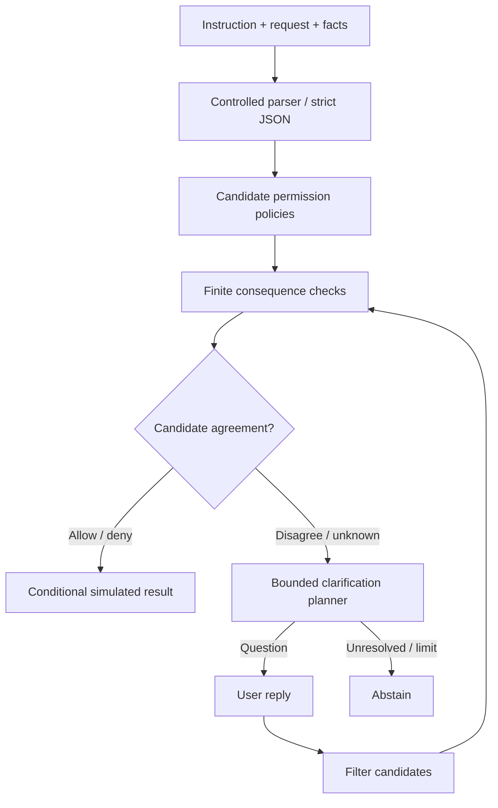

# Architecture and trust boundaries

EIV is a deterministic research system with a standard-library Python runtime.
Its output is a simulated decision plus an inspectable trace.

## Modules

| Module | Responsibility | Trust boundary |
|---|---|---|
| `eiv.logic` | Validate and exhaustively evaluate a finite logical specification | Logic is only as faithful as its supplied formalization |
| `eiv.permissions` | Check operation dimensions, aggregate candidate decisions, replay clarification | Candidate meanings and trusted facts remain external assumptions |
| `eiv.planning` | Memoized bounded decision-tree search | Only candidate IDs, public checks and question partitions; no latent labels |
| `eiv.web` | Loopback HTTP adapter and packaged workbench | Every posted session is revalidated; cached decisions are ignored |
| `eiv_experiment` | Synthetic experiment orchestration and result audits | Oracle answers exist only in experiment drivers |
| `eiv_llm` | Validate and score saved model transcripts | Structural validity does not establish semantic validity |
| `scripts/replay_frozen.py` | Stage archived code and replay historical evidence | Archived hashes are checked before execution |

## Permission contract

Requests identify a domain, action, resource, recipient and duration. A file
request has a null recipient. Message recipients are explicit identifiers.
Session grants include an individual operation. A prohibition on the operation
applies at either requested duration. Absent applicable grants deny; conflicting
grants and prohibitions abstain; unresolved conditions abstain conservatively.
A result is conditional on supplied interpretations, faithful formalization,
correct facts, truthful clarifications and the declared finite bounds.

Clarifications select a partition of existing candidates. They cannot create a
grant, change the request, add a missing interpretation or update facts. An
`other`/`unsure` reply terminates with abstention. Changed input requires a new
session. A SHA-256 digest detects accidental case edits, but is unkeyed and has
no authentication or authorization value.

## Exact planner

For active candidate set S and remaining budget b, a terminal unanimous
allow/deny set resolves |S| candidates without a question. An unresolved stop
resolves zero. Asking a question partitions S and sums optimal child resolution;
its interaction cost is |S| plus the summed child costs. Compare policies by:

1. Greater resolved candidate count.
2. Lower total questions across candidate paths.
3. Earlier original question order (with stopping preferred to fruitless work).

Memoization uses active-set bitmasks and remaining budget. Non-splitting questions
cannot make progress and are excluded. Resource limits raise a dedicated error;
the caller abstains rather than using a partial plan. The model weights supplied
hypotheses equally; it has no learned intent probabilities or empirical human
answer model. This objective is deliberately narrower than “best question.”

## Deployment boundary

The static portfolio is independently hostable. The Python workbench is a
loopback development server, never a public policy enforcement point. There is
no production integration, authentication service, external action execution,
cloud dependency, model download or inference in the normal runtime.
