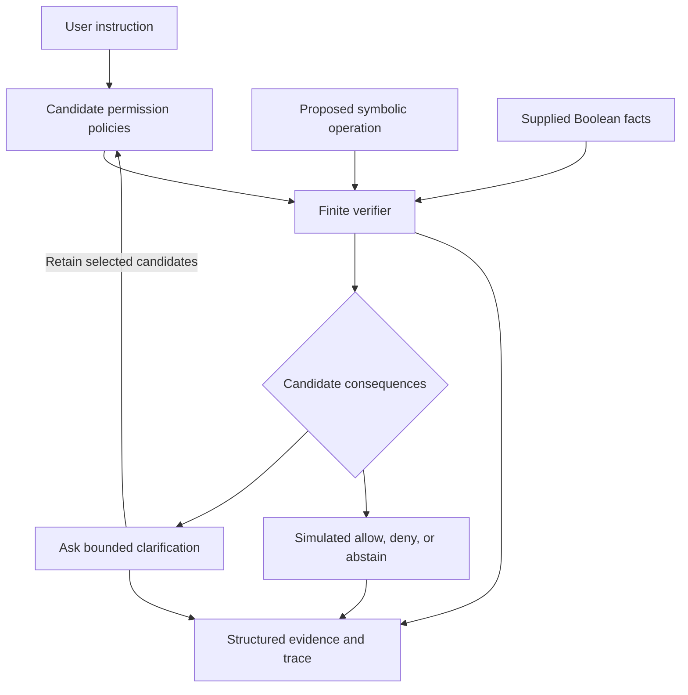

# A formal action model for inspectable agents

EIV explores a foundation for agents and conversational interfaces that make their permission decisions inspectable. A proposed operation is evaluated against explicit candidate policies, and unresolved disagreement can trigger a bounded clarification. The current implementation is a local simulation and research workbench. Connecting its decisions to an agent that executes tools is a proposed extension.

The central design principle is to keep **an instruction, its possible formal meanings, an operation, and the evidence for a decision distinguishable**. A fluent explanation alone does not authorize an operation. A formal check establishes consequences under a represented policy; it does not establish that the policy captures the person's actual intent.

## The implemented decision path



The implemented interface accepts documented controlled English or a structured case. An unrestricted conversational model is not part of the workbench's live decision path. An optional historical local-model pilot is separate evidence, not a deployed chat integration.

The [case schema](../schemas/permission-case.schema.json) and executable validation in [permissions.py](../eiv/permissions.py) define the boundary:

| Object | Current representation | What it establishes |
|---|---|---|
| Instruction | Bounded text; `semantic_status` | Input provenance category, not semantic correctness |
| Operation | `domain`, `action`, `resource`, `recipient`, `scope` | One symbolic request to evaluate |
| Policy candidate | ID, readable interpretation, allow/deny permissions | An explicit hypothesis about permission |
| Facts | Named Boolean values; absent means unknown | Supplied assumptions, without verified provenance |
| Clarification | Disjoint answer groups retaining candidate IDs | A recorded restriction of the hypothesis set |
| Result | Decision, reason, candidate checks, formal results, trace | How the finite computation reached its output |

Supported operations are file read/write/delete and message send. Resources and recipients are bounded identifiers, not filesystem paths or authenticated identities. A session-scoped grant can cover a once-scoped request. These scope labels do not implement expiry, revocation, or consumption of a one-use capability.

Permission matching checks action, resource, recipient, scope, and conditions. The finite theory defines authorization as an applicable grant without an applicable prohibition and rejects contradictory applicable grant/prohibition combinations. Unknown relevant conditions, inconsistent policies, unsupported input, and exhausted bounds can produce abstention. Lack of an applicable permission produces denial within that candidate's semantics.

The interaction layer stops at unanimous allow or deny. Otherwise, it may ask a question or abstain. A selecting answer only removes candidates; it cannot add permission or update facts. `other` and `unsure` terminate with abstention when a question is presented. The optional exact planner optimizes resolved candidate counts within a budget, using equal hypothesis weights; it does not estimate human-intent probabilities or repair missing interpretations.

## A trace grounded in the current schema

The runnable [permission example](../examples/permission-case.json) supplies this instruction:

> You may send report to alex or bea once.

Its request is:

```json
{"domain":"messages","action":"send","resource":"report","recipient":"alex","scope":"once"}
```

Three authored readings grant Alex only (`c1`), Bea only (`c2`), or both (`c3`). For this request their checked decisions are allow, deny, and allow. EIV asks `interpretation`; selecting `c2` retains only the Bea policy. The following events are emitted by the current session API:

```json
[
  {"event":"generated","candidate_ids":["c1","c2","c3"],"semantic_status":"controlled","coverage":"unverified"},
  {"event":"clarification","question":"interpretation","answer":"c2","before":["c1","c2","c3"],"after":["c2"]},
  {"event":"decision","decision":"deny","reason":"candidate_consensus_conditional_on_coverage","active_candidate_ids":["c2"]}
]
```

Candidate-level results additionally expose dimension checks, condition applicability, and the finite specification/result. The selected candidate denies because no permission applies to sending to Alex; an explicit prohibition is unnecessary. The example's natural-language readings remain authored assumptions requiring semantic review.

Here, “intent traceability” means traceability of **represented interpretations and recorded user selections**. The trace is public structured evidence about observable inputs and computation. It is not hidden model chain-of-thought, proof of actual human intent, or evidence that a message was sent. The result remains `simulated: true` and `coverage: "unverified"`. Session digests detect changes to the case; they are not signatures, authentication, or execution credentials.

## The conditional guarantee

Let the active candidate set initially contain a faithful representation \(p^*\) of the intended permission. Assume relevant identities, effects, and conditions are represented adequately; supplied facts are correct; finite evaluation is correct within its bounds; each answer preserves \(p^*\); and the request and facts remain fixed. Then unanimous allow implies that \(p^*\) permits the request in the declared semantics. Unanimous deny implies that it does not.

The argument is membership preservation: \(p^*\) starts in the set, remains after each clarification, and therefore shares a unanimous terminal decision. This is a mathematical contract, not a mechanically verified implementation proof. None of the assumptions follows from schema validity or unanimity alone.

If the Bea-only policy is missing from the example, the remaining candidates both allow sending to Alex. The checker can be correct about both and still emit a false authorization relative to the omitted intent. Logging that consensus improves diagnosis but cannot make it safe.

## Proposed lifecycle for real actions

A future chat agent would propose an operation through a typed adapter and present candidate meanings and clarification choices. Conversation text, retrieved documents, and model explanations would remain untrusted inputs. Trusted facts would come from identified providers under an explicit freshness policy.

A future execution gate would bind a decision to a versioned operation, policy set, identities, and fact snapshot. Changes in recipient, content, resource version, scope, permissions, or relevant state would invalidate that binding and require evaluation again. An adapter would check those conditions immediately before the effect, prevent duplicate execution, and record a success/failure receipt. Simulated allow would not itself bypass the gate.

| Capability | Current status | Required extension |
|---|---|---|
| Fixed request during clarification | Implemented session validation | Versioned operation envelope across an agent lifecycle |
| Inspectable decision evidence | Implemented local JSON export | Versioned event schema, redaction, retention, tamper evidence |
| Facts and policy state | Supplied for a fixed evaluation | Authenticated sources, freshness, revocation, invalidation |
| Tool execution | Not implemented | Execution gate, adapter contracts, duplicate prevention, receipts |

These are proposed controls, not completed enforcement guarantees. Multi-step plans, partial failure, concurrent state changes, rollback, and effects outside the symbolic model require separate semantics and tests.

## Proposed roadmap issues

1. **Version the action and trace contracts.** Accept when schemas identify operation, policy/fact versions, strategy, bounds, clarifications, and outcomes; exported examples round-trip; a validator rejects mismatched references; privacy/redaction behavior is documented.
2. **Build a dry-run agent/chat adapter.** Accept when a complete conversation proposes a typed request, displays competing meanings, handles selecting/`other`/`unsure` answers, and exports a replayable trace. Untrusted chat text cannot silently become a trusted fact. No external effect is enabled.
3. **Prototype an execution gate against a fake tool.** Accept when changed state, revoked permission, request mutation, and duplicate attempts are rejected in integration tests; an accepted operation produces one fake effect and a bound receipt; failure behavior is explicit.
4. **Validate semantics with independent reviewers.** Accept when new permission families have independently reviewed interpretations, disagreements are preserved, evaluation is frozen prospectively, and coverage errors, false allows, false denials, abstention, and question cost are reported separately.

## Research grounding

Interactive parsing and clarification are established in [Yao et al. (2019)](https://aclanthology.org/D19-1547/); editable natural-language/formal mappings in [Cosler et al., nl2spec (2023)](https://link.springer.com/chapter/10.1007/978-3-031-37703-7_18); and missing-interpretation recovery in [Saparina and Lapata (2025)](https://aclanthology.org/2025.findings-acl.863/). [FAVA (2026)](https://arxiv.org/abs/2607.27267) describes permission representations and a runtime authorization gateway. EIV's proposed lifecycle does not claim these mechanisms as new or inherit those systems' empirical results. See the [research report](research-report.md) and [verified bibliography](../research/references.bib) for evidence and publication status.
